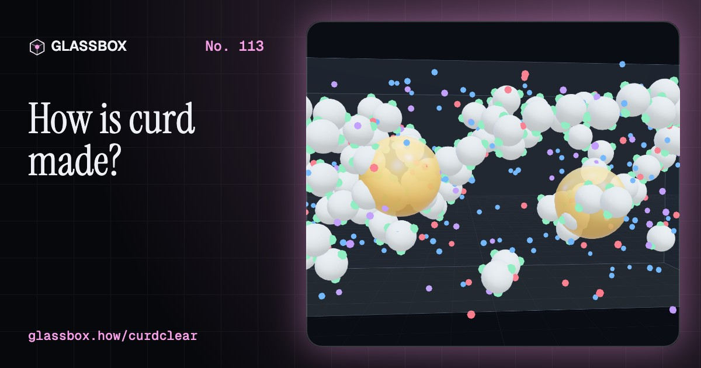
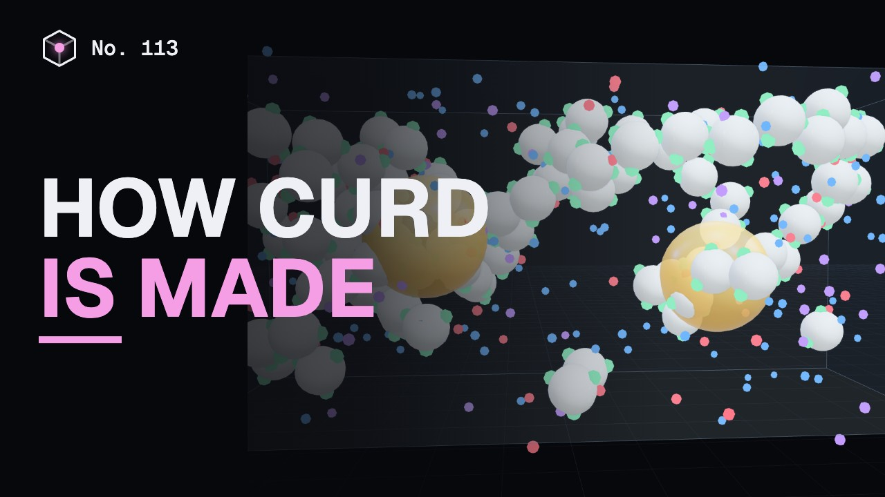
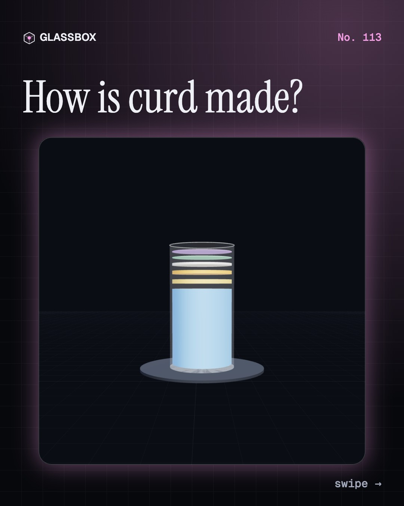
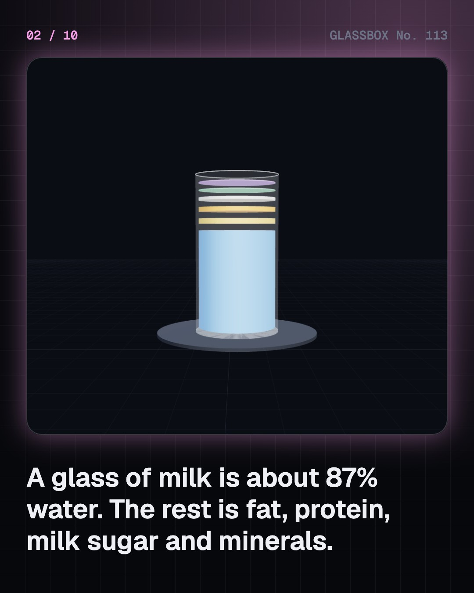
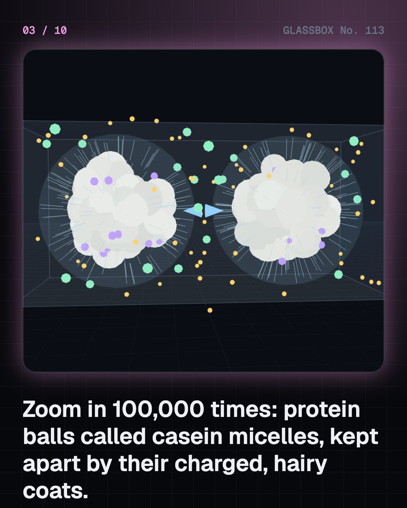
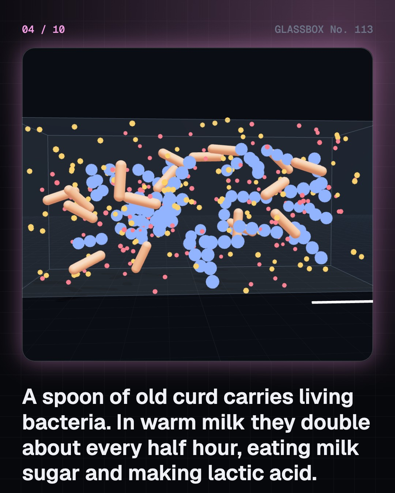

<!-- glassbox:start -->
<!-- Generated from glassbox.json by the Glassbox hub (npm run readme -- curdclear). Edit glassbox.json, not this block. -->
<p align="center"><a href="https://glassbox.how/e/curdclear/"></a></p>

<h1 align="center">CurdClear</h1>

<p align="center"><b>How is curd made?</b><br>A spoon of old curd turns a pot of warm milk solid by morning, and nothing was added but bacteria. Zoom into milk, watch them turn milk sugar into acid, see the proteins link up at pH 4.6, then set your own dahi on a winter night and find out why it needs a blanket.</p>

<p align="center"><a href="https://glassbox.how/curdclear/"><b>▶ Play with it</b></a> &nbsp;·&nbsp; <a href="https://glassbox.how/e/curdclear/">Read the 60-second explainer</a> &nbsp;·&nbsp; <a href="https://glassbox.how/curdclear/glassbox/reel.mp4">Watch the 40-second video</a></p>

<p align="center">
  <a href="https://glassbox.how/e/curdclear/"></a>
  <a href="https://glassbox.how/e/curdclear/"></a>
  <a href="LICENSE"></a>
  <a href="LICENSE-CONTENT.md"></a>
  <a href="#privacy"></a>
</p>

## In 60 seconds

1. **Milk is water with things floating in it.** Cow milk is about 87% water. Lactose, minerals and whey proteins are dissolved in it, fat floats as droplets a few thousandths of a millimetre wide, and casein protein hangs in balls called micelles, about 150 nanometres across. Each micelle has a coat of negatively charged hairs, so micelles push each other away and milk stays liquid.
2. **A spoon of jaman is a spoon of bacteria.** Old curd carries around a hundred million live lactic acid bacteria in every gram. In warm milk they eat lactose and give out lactic acid, and at their best they double about every half hour. Cold slows them almost to a stop and heat above about 50 °C kills them.
3. **At pH 4.6 the milk sets.** The acid pulls the pH down from about 6.7. Hydrogen ions cancel the charge on the micelles, and near pH 4.6, casein's isoelectric point, the micelles stick together into a network. The network traps all the water and fat, so the liquid becomes a soft solid, a gel. Nothing is removed.
4. **Warmth and time decide the pot.** Lukewarm milk at about 40 °C sets in roughly five to seven hours. A bare pot on a cold night cools in a couple of hours and may never set, which is why Indian homes wrap it or tuck it into a casserole. Boiling the milk first clears out rival microbes and makes the gel about twenty times stiffer.
5. **Whey and sourness have causes.** The greenish water on curd is whey, squeezed out as the protein network tightens. Leaving the pot warm for too long, setting it too hot, or shaking it while it sets all make it worse. Sourness is simply more lactic acid, and a fridge nearly stops the bacteria that make it.
6. **One trick, many foods.** Yoghurt is curd made with two named bacteria at about 42 °C. Paneer uses acid in hot milk and no bacteria. Cheese uses rennet, an enzyme that cuts the hairs off the micelles. From dahi itself come lassi, chaas, shrikhand and mishti doi.

## Words worth knowing

| Term | Meaning |
|---|---|
| **Casein micelle** | A ball of casein protein and calcium phosphate about 150 nanometres across. Milk holds around a hundred trillion in every millilitre. |
| **Lactose** | Milk sugar, about 4.8% of milk. Lactic acid bacteria ferment part of it into lactic acid. |
| **Lactic acid bacteria** | Harmless bacteria, such as Lactococcus, Streptococcus thermophilus and Lactobacillus, that turn sugars into lactic acid. |
| **Jaman (starter)** | A spoon of old curd stirred into warm milk. Its live bacteria make the next batch. |
| **pH** | A scale of acidity. Fresh milk is about 6.7 and set curd about 4.6. Each unit down means ten times more hydrogen ions. |
| **Isoelectric point** | The pH at which a protein has no net charge. For casein it is 4.6, and there the micelles stick together. |
| **Gel** | A soft solid made of a thin network that traps a lot of liquid. Curd is a gel of casein holding water and fat. |
| **Whey and syneresis** | Whey is the watery part of milk. Syneresis is a gel shrinking and squeezing whey out. |
| **Rennet** | Enzymes that clot milk for cheese by cutting the kappa-casein hairs off the micelles, with no acid needed. |

## A short history

**Nearly 9,000 years from milk left in a clay pot to the bacteria in every cup of dahi.**

- **6500 BCE** · Milk fat in the oldest pots (Neolithic farmers, North-western Anatolia (today Turkey))
- **2500 BCE** · Dairy in the Indus valley (People of the Indus Valley Civilisation, Kotada Bhadli, Gujarat)
- **1200 BCE** · Dadhi in the Vedas (Composers of the Vedic hymns, North-western Indian subcontinent)
- **1073** · The word yoghurt is written down (Mahmud al-Kashgari, Baghdad)
- **1780** · The acid in sour milk (Carl Wilhelm Scheele, Köping, Sweden)
- **1857** · Souring is the work of living microbes (Louis Pasteur, Lille, France)
- **1905** · The yoghurt bacillus (Stamen Grigorov, Geneva, Switzerland)
- **1919** · Danone begins in Barcelona (Isaac Carasso, Barcelona, Spain)

The full story, with 30 moments, charts, people and 51 sources: [glassbox.how/e/curdclear/history](https://glassbox.how/e/curdclear/history/). The data lives in [`history.json`](history.json).

## Video and slides

Made with the Glassbox studio from this box's storyboard (`window.glassbox.director`). Free to reuse under CC BY 4.0.

<a href="https://glassbox.how/curdclear/glassbox/video.mp4"></a>

<p><a href="glassbox/slide-1.jpg"></a> <a href="glassbox/slide-2.jpg"></a> <a href="glassbox/slide-3.jpg"></a> <a href="glassbox/slide-4.jpg"></a></p>

| File | What | Size |
|---|---|---|
| [`glassbox/reel.mp4`](https://glassbox.how/curdclear/glassbox/reel.mp4) | Reel / Short, with captions and soundtrack | 1080×1920 |
| [`glassbox/video.mp4`](https://glassbox.how/curdclear/glassbox/video.mp4) | YouTube video, with captions and soundtrack | 1920×1080 |
| `glassbox/slide-1…10.jpg` | Instagram carousel | 1080×1350 |
| `glassbox/thumb.jpg` | YouTube thumbnail | 1280×720 |
| `glassbox/cover.jpg` | Share card and repo social preview | 1200×630 |
| [`glassbox/history-reel.mp4`](https://glassbox.how/curdclear/glassbox/history-reel.mp4) | “History in 10 moments” Reel / Short | 1080×1920 |
| `glassbox/history-slide-*.jpg` | History carousel | 1080×1350 |
| `glassbox/post.json` | Post copy and schedule used by the publish kit | |

## Privacy

This box has no accounts and no ads, and it ships its own fonts and libraries. When you run it yourself it sends nothing anywhere. On glassbox.how, the site's `/bar.js` also loads Glassbox's analytics: **Google Analytics** to count visits (it asks first in the EU, UK and Switzerland, and stays off when your browser sends Global Privacy Control or Do Not Track) and **ClickTrust** to detect bots.

It remembers a few things **in your own browser only**, and never sends them anywhere:

| Browser storage key | What it holds |
|---|---|
| `curdclear.v1` | Which chapters you have opened, your best quiz scores, and sound on or off. |

Exactly what each one sees is at [glassbox.how/privacy](https://glassbox.how/privacy/).

## Licences

- **Code:** [MIT](LICENSE). Use it, change it, ship it.
- **Explanations, text, images and videos** (`glassbox.json`, `glassbox/`): [CC BY 4.0](LICENSE-CONTENT.md). Credit “Glassbox, glassbox.how/e/curdclear”.
- **Third-party parts** keep their own licences: [three.js](https://threejs.org) (MIT), [Geist, Instrument Serif](https://openfontlicense.org) (SIL OFL 1.1).
- The Glassbox name and logo aren't covered by either licence. See the [terms](https://glassbox.how/terms/).

Found a mistake? [Open an issue](https://github.com/bdeeps/curdclear/issues). Corrections happen in public.
<!-- glassbox:end -->

## Run it

It's plain HTML, CSS and JavaScript. No build step and no dependencies. Run locally, it contacts no other website.

```bash
python3 -m http.server 8000
```

Three.js and the fonts ship in `vendor/` and `fonts/`, so it also works offline.

Then open http://localhost:8000.

## How it's built

| File | What |
|---|---|
| `index.html`, `css/app.css` | The page and its styles |
| `js/app.js`, `js/stage.js`, `js/ui.js`, `js/kit.js` | The shared Glassbox 3D engine: chapters, 3D stage, controls, quiz, video director |
| `js/curd.js` | The food science shared by every chapter: milk composition, the growth of lactic acid bacteria (cardinal temperature model), acid production (Luedeking–Piret), the pH and gel-firmness curves, the cooling pot, the micelle model and the chart boards |
| `js/chapters/*.js` | One file per chapter: the 3D model, controls, text, key terms, quiz and video scenes |
| `glassbox.json` | Title, question, explainer beats, key terms, browser storage and credits shown on glassbox.how |
| `reel` in each chapter | The storyboard the Glassbox studio records into short videos |
| `glassbox/` | The published video, slides, thumbnail and post copy |
| `fonts/`, `vendor/three/` | Self-hosted Geist and Instrument Serif (SIL OFL 1.1) and three.js (MIT) |
